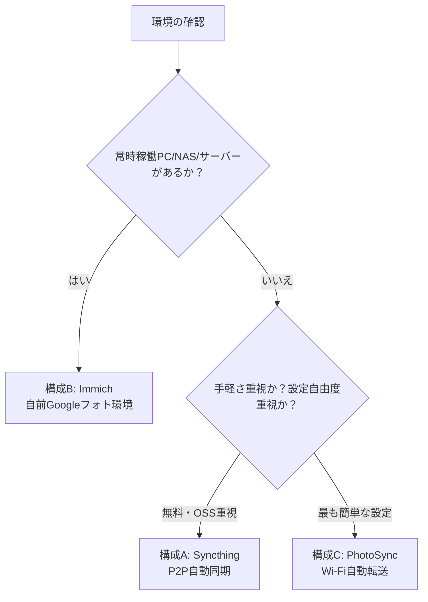

# Googleフォト容量逼迫対策：アーキテクチャ選定ガイド

## 1. 現状の課題と前提条件

Googleアカウントの無料容量（15GB）のうち **13.87GB** を使用しており、残りは約1.1GBです。
Googleアカウントの容量は、Googleフォトだけでなく **GmailやGoogleドライブと共有** されているため、容量が100%に達すると **メールの受信や新規ファイルの保存ができなくなります**。

### 技術的な制約（2025年3月以降のGoogle仕様変更）
1. **Google Photos APIによる一括ダウンロードの制限**:
   - Googleの仕様変更により、サードパーティ製ツール（rclone、gphotos-syncなど）から過去のライブラリ全件を取得・ダウンロードすることはAPI経由で不可能になりました。
   - 一括エクスポートには公式の **Google Takeout（データのエクスポート）** が必須です。
2. **削除エンドポイントの不在**:
   - Google Photos APIには写真を削除するエンドポイントがありません。
3. **スマホ同期の道連れ削除リスク**:
   - スマホの「バックアップ」が有効のままクラウド（Web版含む）から写真を削除すると、**スマホ本体の写真も同時に消去** されます。

そのため、対策は以下の2段階で進めます：
- **【即時対応】フェーズ1: 既存の写真データをローカルに救出し、安全にクラウド容量を空ける**
- **【恒久対応】フェーズ2: 今後撮影する写真を自動でローカル（PC/NAS）に同期し、クラウドを圧迫しない仕組みを構築する**

---

## 2. ユーザー利用環境別の推奨構成（アーキテクチャ選定）

お使いの端末環境（PC/スマホ/サーバー有無）に合わせて、以下の3つの構成から最適なものを選択できます。

### 構成比較表

| 項目 | 構成A: Syncthing（推奨・汎用） | 構成B: Immich（最高機能） | 構成C: PhotoSync（最も手軽） |
| :--- | :--- | :--- | :--- |
| **特徴** | 完全無料・OSS・直接P2P同期 | 自宅サーバーでGoogleフォト完全再現 | スマホアプリ導入だけで直感的に設定可能 |
| **必要機器** | 通常のPC（Win/Mac）＋ スマホ | 常時起動PC / NAS / Docker環境 | 通常のPC（共有フォルダ）＋ スマホ |
| **スマホ側アプリ** | Syncthing-Fork (Android) / Möbius Sync (iOS) | Immich (iOS / Android) | PhotoSync (iOS / Android) |
| **閲覧インターフェース** | PCの通常ファイルビューア / フォト | Webブラウザ / スマホアプリ（AI顔認識・地図） | PCの通常ファイルビューア / フォト |
| **クラウド利用** | なし（または節約画質で併用） | なし（完全ローカル） | なし（または節約画質で併用） |
| **向いている人** | PC起動時に自動で吸い上げたい方 | Googleフォトの検索やUI体験をそのまま残したい方 | 面倒な設定なしですぐに自動転送したい方 |

---

### 詳細構成

#### 構成A: Syncthing による P2P 自動同期（おすすめ・標準）
- **仕組み**: スマホの「カメラ（DCIM）」フォルダとPCの指定フォルダ（外付けHDD等）を直接ペアリング。Wi-Fi接続時や充電中にバックグラウンドで差分同期。
- **メリット**:
  - 外部サーバー不要、クラウドを介さず暗号化P2P通信で高速。
  - 「スマホ側からPCへ送信専用（Send Only）」に設定することで、スマホ側で写真を削除してもPC側のバックアップは消えない設定が可能。

#### 構成B: Immich によるプライベートフォトクラウド（サーバー・NAS向け）
- **仕組み**: 自宅のPC/NASにDockerでImmichサーバーを稼働させ、スマホアプリから自動アップロード。
- **メリット**:
  - Googleフォトとほぼ同一のUI（タイムライン、顔認識、物体検索、地図検索、アルバム共有）。
  - Google Takeoutで落とした過去写真も `immich-go` を使って一括インポート可能。

#### 構成C: PhotoSync による自動転送（シンプル運用）
- **仕組み**: スマホにPhotoSyncアプリを入れ、PC側の共有フォルダ（SMB）またはPhotoSync Companionアプリへ「自宅Wi-Fi接続時」や「充電開始時」に自動送信。
- **メリット**:
  - 最も設定が平易で、iOS/Androidともに安定したバックグラウンド転送が可能。
